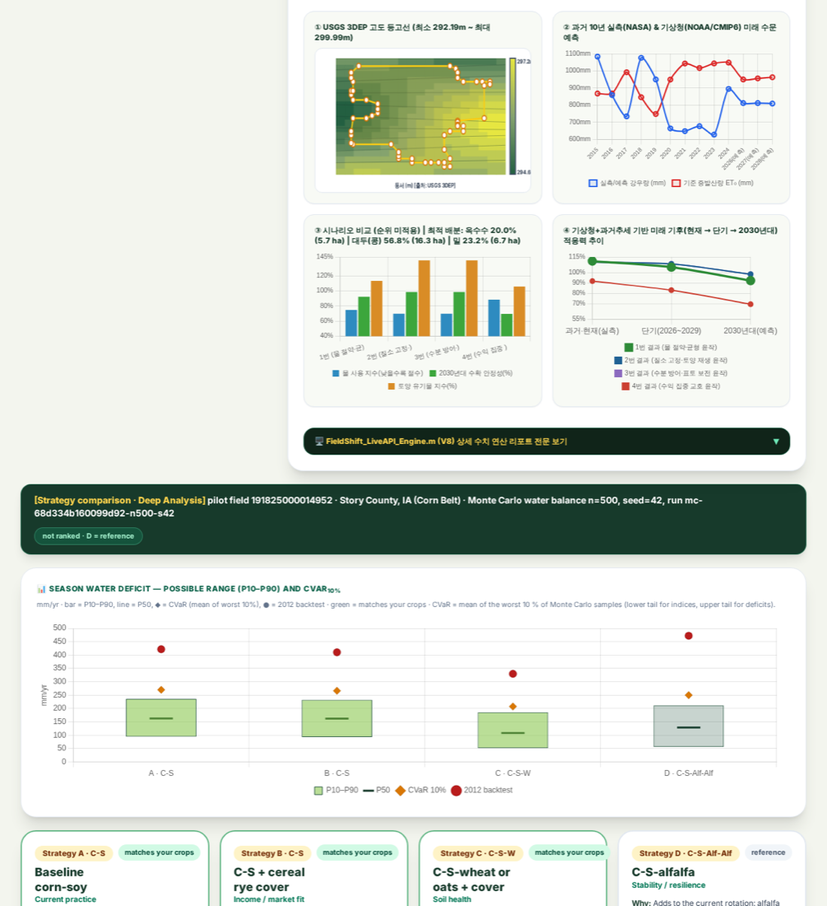
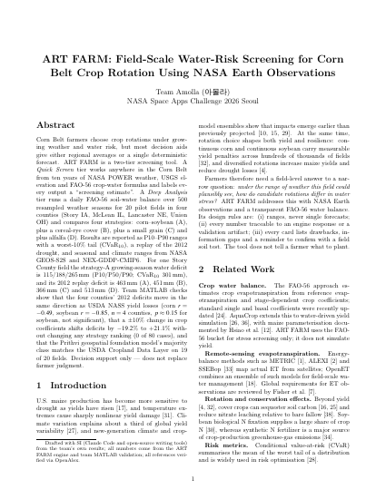
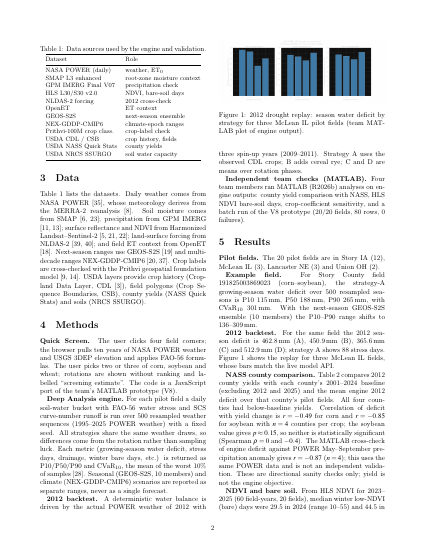
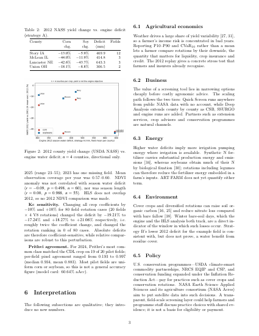
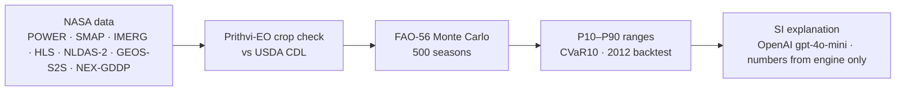

<div align="center">


<p>
<a href="https://watts-astrology-asus-blessed.trycloudflare.com"></a>
<a href="https://drive.google.com/file/d/1mrTBy1BNMSToOB3PpFKjQZMX_heUaC02/view?usp=drive_link"></a>
<a href="https://cloudsnuchoi.github.io/2026NASA/paper/artfarm_paper.pdf"></a>
<a href="https://cloudsnuchoi.github.io/2026NASA/demo/"></a>
</p>

<a href="https://watts-astrology-asus-blessed.trycloudflare.com"></a>

</div>

## Research Paper

<p align="center">
<a href="https://cloudsnuchoi.github.io/2026NASA/paper/artfarm_paper.pdf"></a>
<a href="https://cloudsnuchoi.github.io/2026NASA/paper/artfarm_paper.pdf"></a>
<a href="https://cloudsnuchoi.github.io/2026NASA/paper/artfarm_paper.pdf"></a>
</p>
<p align="center"><a href="https://cloudsnuchoi.github.io/2026NASA/paper/artfarm_paper.pdf"></a><br/><sub>Drafted with SI; references verified via OpenAlex. Decision support only — does not replace farmer judgment.</sub></p>

## Pipeline



**Data & Sources:** [docs/DATA_SOURCES.md](docs/DATA_SOURCES.md) · **SI disclosure:** [docs/submission/submission-form.md §6](docs/submission/submission-form.md) · **Team Amolla:** see Team below.

# 2026NASA · Field Shift


**Architecture:** [docs/ARCHITECTURE.md](docs/ARCHITECTURE.md) · **Status dashboard:** [docs/dashboard/](docs/dashboard/index.html) ([GitHub Pages](https://cloudsnuchoi.github.io/2026NASA/dashboard/))

Readable Pages: [Status board](https://cloudsnuchoi.github.io/2026NASA/dashboard/) · [Roadmap & checklist](https://cloudsnuchoi.github.io/2026NASA/roadmap.html) · [Datasets](https://cloudsnuchoi.github.io/2026NASA/data.html) · [Architecture & pipeline](https://cloudsnuchoi.github.io/2026NASA/architecture.html) · [SI models](https://cloudsnuchoi.github.io/2026NASA/models.html) · [Overview / PRD](https://cloudsnuchoi.github.io/2026NASA/overview.html) · [Team](https://cloudsnuchoi.github.io/2026NASA/team.html)

**Team drive (Team Amolla):** [Shared Google Drive folder](https://drive.google.com/drive/folders/1pUlXbE_VNiMGHVYSkHHT4Mr-nzo--Yqd) — subfolders `PRD`, `DESIGN`, `FRONT`, `BACK`, `DATA`.

**Team Amolla** · [NASA Space Apps Challenge 2026](https://www.spaceappschallenge.org/2026/challenges/adapting-farms-with-nasa-data/) (Seoul) · Challenge 07 *Field Shift: Adapting Farms with NASA Data*.

A **decision-support** tool for Corn Belt corn–soy farmers. It compares crop-rotation strategies that may improve soil health and resilience to weather and water, using NASA Earth observations. It **supports, and does not replace**, farmer judgment and local agronomic expertise.

Repository: [github.com/cloudsnuchoi/2026NASA](https://github.com/cloudsnuchoi/2026NASA) · License: [Apache-2.0](LICENSE)

---

## What this prototype decides

**Question.** What crop to add to or change in an existing rotation to improve soil health and resilience to weather and water?

**Where.** Two tiers. Tier 1 covers the 12-state Corn Belt (`IA, IL, IN, OH, NE, MN, SD, WI, MO, KS, MI, KY`) at **county aggregates**. Tier 2 is field-scale (30 m) in **Story County, Iowa** (`county_fips=19169`). A Nebraska water-limited contrast remains optional and cuttable.

**Strategies compared**

| Code | Rotation |
| --- | --- |
| `A` | Baseline corn–soy (`C-S`) |
| `B` | `C-S` plus a winter cereal rye cover crop |
| `C` | `C-S`–wheat or oats plus a cover crop |
| `D` | `C-S`–alfalfa (forage, nitrogen fixation, deep roots; water-use risk must be flagged, especially in the West) |

**Outputs.** Bare-field periods, vulnerable seasons, a multi-criteria comparison, and per-strategy *why / evidence / benefits / information gaps / local-review risks*, with priority sliders and a field map. Uncertainty is shown with Monte Carlo percentiles and CVaR. Validation is a CDL / Crop Sequence Boundaries backtest. County yields are an optional side axis (NASS bulk files if the QuickStats API is unreachable).

AI is organized in four layers: **vision** (Prithvi crop-classification checkpoint, inference only, CDL fallback) → **forecast/scenarios** (NASA GEOS-S2S seasonal ensemble, NASA NEX-GDDP-CMIP6 for the 2030s; distributions only) → **simulation** (Monte Carlo water balance + CVaR, rule/index scoring) → **LLM explanation** with tool-calling and citation-only RAG. The live engine for this weekend is **rule/index scoring + Monte Carlo + CVaR**. There is no reinforcement learning and no model fine-tuning. An LLM may call the model API and attach citations; it does not compute numbers. MATLAB is **offline only** (analysis and calibration exported to the database).

---

## Team docs (source of truth)

These documents are frozen in Korean. Identifiers in code stay English.

| Doc | Role |
| --- | --- |
| [docs/ARCHITECTURE.md](docs/ARCHITECTURE.md) | System architecture, **build vs service pipelines**, decision model, collaboration workflow, AI 4 layers and algorithms |
| [docs/dashboard/](docs/dashboard/index.html) | Live team board: per-member `STATUS:` comments, countdown, area bars, PR queue. Also on [GitHub Pages](https://cloudsnuchoi.github.io/2026NASA/dashboard/) |
| GitHub Pages explainers | Tabs: [Status board](https://cloudsnuchoi.github.io/2026NASA/dashboard/), [Roadmap & checklist](https://cloudsnuchoi.github.io/2026NASA/roadmap.html), [Datasets](https://cloudsnuchoi.github.io/2026NASA/data.html), [Architecture & pipeline](https://cloudsnuchoi.github.io/2026NASA/architecture.html), [SI models](https://cloudsnuchoi.github.io/2026NASA/models.html), [Overview / PRD](https://cloudsnuchoi.github.io/2026NASA/overview.html), [Team](https://cloudsnuchoi.github.io/2026NASA/team.html) |
| [docs/TEAM_SPEC.md](docs/TEAM_SPEC.md) | Product lock status, user flow & screens, requirement traceability, data mapping, AI 4-layer architecture, data spike, roles & handoff contracts, CLI guide, timeline |
| [docs/PRD.md](docs/PRD.md) | Problem, users, decision, scope, success criteria, demo, cut order |
| [docs/SOT.md](docs/SOT.md) | Datasets, IDs/units/CRS, aggregation, directories, DB schema, API contract |
| [docs/CHECKLIST.md](docs/CHECKLIST.md) | 16-hour timeline (KST) and Space Apps submission checklist |
| [docs/DECISIONS.md](docs/DECISIONS.md) | Decision log |
| [docs/si-log.md](docs/si-log.md) | Use of AI (SI) log for the submission form |
| [AGENTS.md](AGENTS.md) | Rules for Codex CLI / Gemini CLI (agy) agents, per role |
| [GEMINI.md](GEMINI.md) | Gemini CLI entry point (imports AGENTS.md) |
| [CONTRIBUTING.md](CONTRIBUTING.md) | Issue → branch → PR → one review → squash merge; hourly 10-minute sync |
| [infra/agent-loop/](infra/agent-loop/README.md) | Always-on agent on each member's laptop: `!task #N` in a 1:1 channel → Codex/agy run → PR and STATUS |

---


---

## Team Google Drive (Team Amolla)

Shared folder: [drive.google.com/drive/folders/1pUlXbE_VNiMGHVYSkHHT4Mr-nzo--Yqd](https://drive.google.com/drive/folders/1pUlXbE_VNiMGHVYSkHHT4Mr-nzo--Yqd)

| Folder | What goes here |
| --- | --- |
| `PRD` | Slides, pitch, submission materials |
| `DESIGN` | Figma exports, images |
| `FRONT` | Non-code frontend assets, screenshots |
| `BACK` | Non-code backend assets, screenshots |
| `DATA` | MATLAB outputs and small CSVs. Large rasters and bulk files stay on the VPS (`/srv/hackathon/data`) |

**Code always stays in GitHub.** Do not upload source repositories to Drive.

## Repository layout

```text
data_pipeline/   # ETL, manifests, QA (raw data stays on the VPS under /data/raw)
model_api/       # FastAPI model service
rag/             # Evidence cards and citation search
frontend/        # Public, no-login demo UI
matlab/          # Offline analysis only (fixed Parquet/CSV outputs)
sim/             # three.js voxel simulation for the demo video
infra/           # Docker Compose, Postgres + PostGIS + pgvector
notebooks/       # EDA
docs/            # PRD, SOT, architecture, checklist, decisions, status dashboard, explainer Pages
```

Do not commit secrets or raw/processed rasters. See `.gitignore` and the directory rules in [docs/SOT.md](docs/SOT.md).

---

## Stack (weekend)

- API: FastAPI (`model_api/`)
- Database: Postgres + PostGIS + pgvector (evidence cards only; keyword+DOI fallback if embeddings slip)
- Frontend: public URL with no login
- Hosting: team VPS (see `infra/`)
- NASA inputs (minimum one, preferably more): POWER, GPM IMERG, SMAP (context cell only), HLS (Landsat/Sentinel-2), SRTM, NLDAS-2, GEOS-S2S, NEX-GDDP-CMIP6 — full table in SOT

---

## Space Apps submission reminders

- Deadline: **2026-11-15 23:59 Asia/Seoul (KST)**; aim to finish by 23:55.
- Demo: **≤30-second video** or **≤7 slides including title**. English (or English subtitles).
- Links must open **without** a login, password, or sign-up.
- Use **at least one NASA dataset or resource** for global-award eligibility. List NASA Data and Other Data separately, with licenses in References.
- Disclose SI (AI) use. Do not use or alter NASA logos, flags, or mission identifiers.

Official challenge: https://www.spaceappschallenge.org/2026/challenges/adapting-farms-with-nasa-data/


