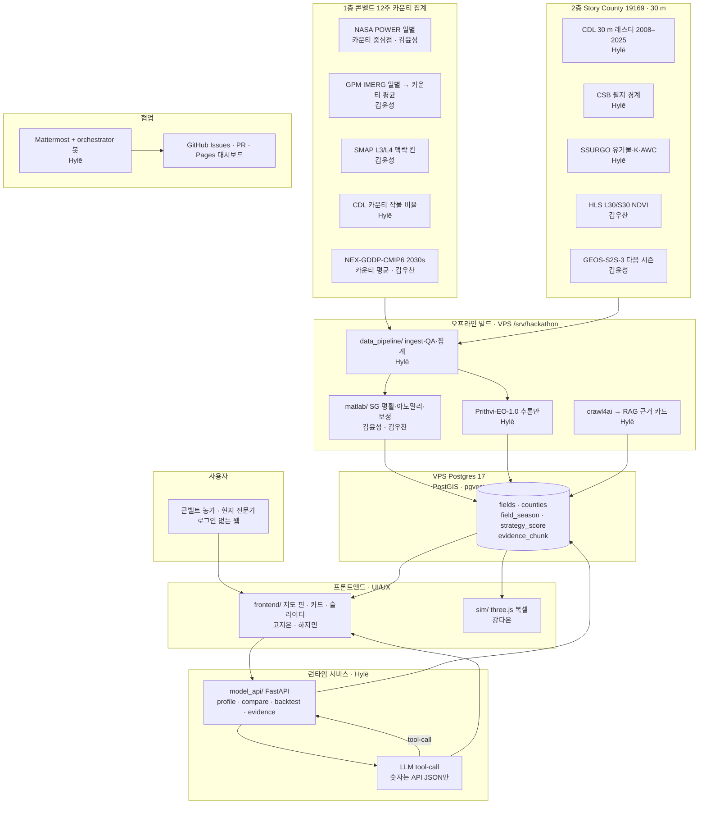
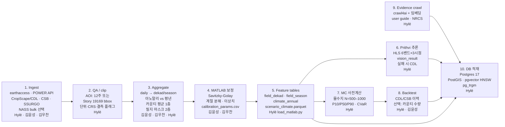
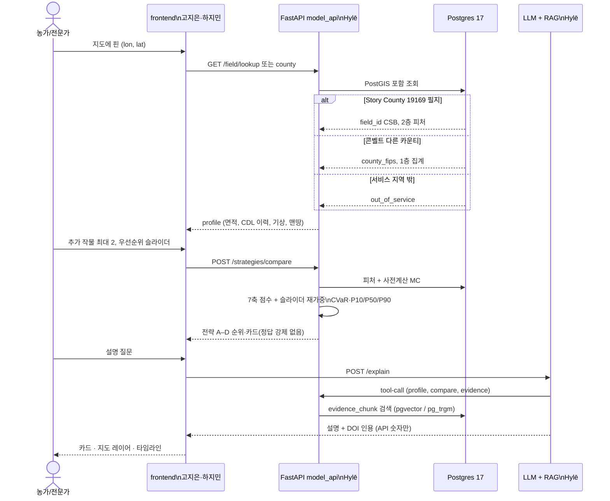
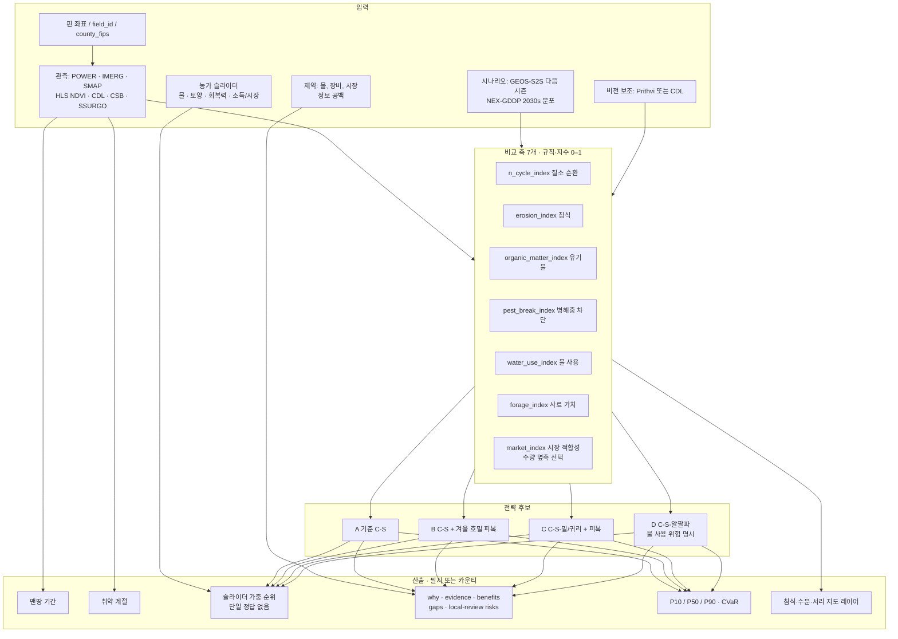
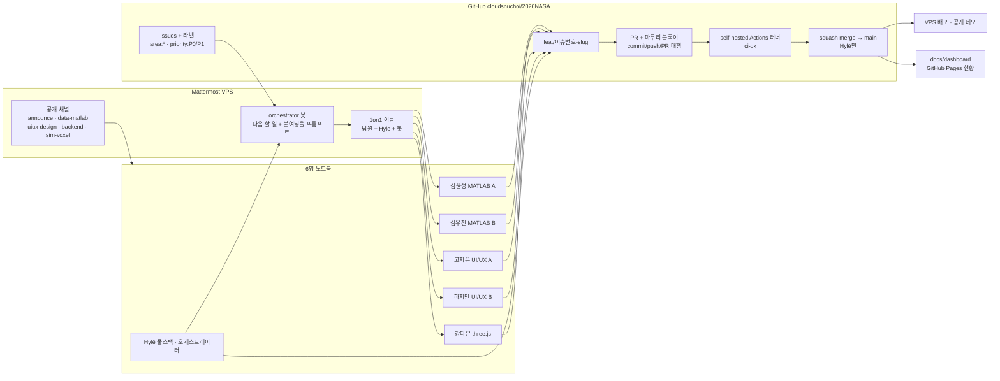

# ARCHITECTURE · 시스템 구조와 파이프라인

팀 **아몰라** · `cloudsnuchoi/2026NASA` · 챌린지 07 *Field Shift*  
작성 **2026-11-15 11:10 Asia/Seoul (KST)**. 마감 **2026-11-15 23:59 KST**.

이 문서는 **시스템 구조, 빌드(오프라인) 파이프라인, 서비스(런타임) 파이프라인, 의사결정 모델, 협업 흐름, AI 4층·알고리즘**의 단일 그림 원본이다. 필드명·단위·엔드포인트는 [SOT.md](./SOT.md)가 이긴다. 제품 범위는 [PRD.md](./PRD.md). 역할·인계는 [TEAM_SPEC.md](./TEAM_SPEC.md). 진행 현황은 [status dashboard](./dashboard/index.html).

식별자·데이터셋·도구·경로 이름은 영어, 설명은 한국어.

---

## 0. 한 줄로

콘벨트 옥수수–대두 농가가 지도에 핀을 찍으면, NASA 지구관측과 필지 이력을 바탕으로 **기존 윤작에 무엇을 추가·변경할지** 전략 A–D를 비교해 주는 **판단 보조 도구**다. 농부 판단을 대체하지 않는다.

- **공간, 두 층.** 1층 = 콘벨트 12개 주 카운티 집계 지도. 2층 = 아이오와 **Story County** (`county_fips=19169`) 필지 30 m 정밀 분석.
- **숫자.** 규칙·지수 스코어링 + 몬테카를로 물수지 + CVaR. LLM은 숫자를 만들지 않는다.
- **MATLAB.** 라이브 경로에 없음. 오프라인 보정·평활 결과만 DB에 적재.
- **수확량.** 옆축(시장 적합성)이며, USDA QuickStats API는 **선택**. 대체는 NASS 일괄 파일, 실패 시 생략.

---

## 1. 전체 시스템 구조

각 노드에 **데이터셋 또는 도구 / 담당**을 적었다.

**VPS 경로.** 원본 `/srv/hackathon/data/raw/<dataset>/`(불변, SOT 약칭 `/data/raw`). 가공 `/srv/hackathon/data/processed/vN`. 앱 DB는 서버 내부 Postgres만, 외부 노출은 Cloudflare 터널.

**콘벨트 12주.** `IA, IL, IN, OH, NE, MN, SD, WI, MO, KS, MI, KY`.

---

## 2. 빌드 파이프라인 (오프라인)

요청 경로에 MATLAB·Prithvi GPU·크롤러를 두지 않는다. 결과는 테이블·Parquet으로 DB에 들어간 뒤 서비스가 읽는다.

처리 규칙 (SOT와 동일):

| 단계 | 규칙 | 담당 |
| --- | --- | --- |
| Ingest | 1층은 카운티 집계만. 2층 30 m는 Story만. 원본 덮어쓰기 금지. Earthdata는 `~/.netrc` | Hylē, MATLAB |
| QA / clip | 저장 CRS `EPSG:4326`, 분석 `EPSG:5070`. SMAP·IMERG·POWER·GEOS-S2S·NEX는 필지 정밀 값처럼 쪼개지 않음 | Hylē |
| Aggregate | 일·10일 순(`dekad`)·계절(`MAM/JJA/SON/DJF`)·연. 아노말리는 같은 격자 평년 대비 | 김윤성, 김우찬 |
| MATLAB | 출력은 고정 스키마 CSV/Parquet만. git 없이 `/data/processed`에 저장, Hylē가 커밋·적재 | 김윤성, 김우찬 |
| Prithvi | `Prithvi-EO-1.0-100M-multi-temporal-crop-classification` **추론만**. 요청 경로 GPU 금지 | Hylē |
| MC 사전계산 | 과거 연 재표본 + GEOS-S2S/NEX 시나리오 이동. 런타임은 가중 재계산 | Hylē |
| Backtest | 필수 대조는 CDL/CSB. 카운티 수량은 있으면 기입, 없으면 `null` | Hylē, 김윤성 |
| RAG | 데이터 탐색용이 아님. 근거 카드(가이드·NRCS·피복 문헌)만. P0 적재 후 | Hylē |

**수확량 입력 (선택).** QuickStats API 사이트 접속 실패(2026-11-15). 대체는 NASS Large Datasets. 안내 URL `https://www.nass.usda.gov/datasets/` 는 같은 시각 리다이렉트 후 origin 500. **확인된 호스트** `https://sb.nass.usda.gov/datasets/` (HTTP 200). 작물 파일 `qs.crops_20261103.txt.gz` (1,132,568,713 bytes, Last-Modified 2026-11-03 08:14 UTC = **17:14 KST**, HTTP 200, 키 없음). 콘벨트 12주·카운티·옥수수/대두·연 수량만 필터. 실패 시 생략.

---

## 3. 서비스 파이프라인 (런타임)

공개 URL, 로그인 없음. 한 요청 안에서 MATLAB이나 위성 원본 다운로드를 돌리지 않는다.

화면 흐름 (TEAM_SPEC S0–S7): 핀 → 필지/카운티 프로필 → 작물 선택 → 탭 4장 → 상세(과거 1–5년, 미래 **분포만**) → 용어 카드 → “판단을 대체하지 않음”.

주요 엔드포인트는 SOT 6절: `GET /health`, `GET /field/{id}/profile`, `GET /field/{id}/bare-periods`, `GET /field/{id}/vulnerable-seasons`, `POST /strategies/compare`, `GET /validation/backtest`, `GET /evidence/search`, `GET /maps/{field_id}/{layer}`, `POST /explain`, `GET /sim/{field_id}/scene`.

---

## 4. 의사결정 모델

돕는 결정: **기존 옥수수–대두 윤작에 어떤 작물을 추가하거나 바꾸면, 토양 건강이 좋아지고 날씨·물 조건에 더 잘 버틸까?**

가중은 슬라이더로만 바뀌고, 원점수와 분포는 유지한다. 유기물·질소의 확정 kg, 병해충 손실액은 자동 수치화하지 않는다.

---

## 5. 협업·개발 워크플로

팀원 전원 깃 초보이므로, **Codex CLI / Gemini (agy) CLI가 git을 대행**하고, 머지는 Hylē만 한다. main은 PR로만 변경(admin 우회는 Hylē).

운영 규칙:

- 상태의 원본은 GitHub(이슈·PR·커밋). Mattermost는 지시와 보고.
- 프롬프트 끝의 마무리 블록이 브랜치·커밋·PR을 만든다. MATLAB 두 명은 git을 쓰지 않는다.
- 30분마다 레포 점검 다이제스트. 매시 10분 팀 싱크.
- CI 워크플로 파일(`.github/workflows/`)은 이 작업에서 추가하지 않는다. 토큰에 `workflow` 범위가 없다. 초안은 `infra/ci/ci.yml`.

---

## 6. AI 4층과 알고리즘

### 6.1 층

| 층 | 이름 | 모델·도구 | 입력 → 출력 | 라이브 경로 | 담당 |
| --- | --- | --- | --- | --- | --- |
| L1 | 비전 | `Prithvi-EO-1.0-100M-multi-temporal-crop-classification` 추론만 (Apache-2.0). 실패 시 CDL | HLS 6밴드×3시점 → `vision_result` (작물·맨땅, CDL 일치율) | 아니오 (배치) | Hylē |
| L2 | 예측·시나리오 | NASA GEOS-S2S-3 앙상블, NASA NEX-GDDP-CMIP6 (SSP2-4.5/5-8.5, delta). WeatherNext는 선택·이번 주말 컷 | 격자 시나리오 → `scenario_climate` 분포. 3년 결정론적 예보 금지 | 아니오 (사전 계산) | 김윤성 (S2S), 김우찬 (NEX) |
| L3 | 시뮬레이션 | 규칙·지수 7축 + 몬테카를로 물수지 + CVaR. Python/NumPy. FastAPI | 피처 + 슬라이더 → 전략 카드, P10/P50/P90, CVaR | 예 (사전 계산 + 재가중) | Hylē |
| L4 | 설명 | LLM tool-call + RAG(pgvector, 인용·DOI 전용). 임베딩 실패 시 `pg_trgm` 키워드 | API JSON + `evidence_chunk` → 설명 문장 | 예 | Hylē |

쓰지 않음: 강화학습, 미세조정, WeatherNext 본편 의존, 요청 경로의 MATLAB/WOFOST, 별도 벡터 DB, LLM의 숫자 생성.

### 6.2 알고리즘·방법 목록

| ID | 알고리즘 | 쓰임 | 구현 |
| --- | --- | --- | --- |
| `sg_smooth` | Savitzky–Golay 평활 | NDVI·기상 시계열 잡음 제거 | MATLAB 오프라인 → CSV |
| `seasonal_decomp` | 계절·추세 분해 | 취약 계절, 평년 대비 아노말리 | MATLAB 오프라인 |
| `anomaly` | 같은 격자 평년 대비 편차 | SMAP·강수·기온 표시와 입력 | MATLAB / Python |
| `bare_detect` | NDVI 시계열 + CDL 연 라벨 | 맨땅 시작·끝·일수 | 김우찬, Hylē |
| `fao56` | FAO-56 ET0, `ETc = ET0 × Kc` | 물수지의 증발산. Kc는 문헌 범위 | Python, 작물 테이블 |
| `wb_mc` | 일 물수지 `SM = SM + P − ETc − 유출/배수`, 용량 = SSURGO AWC × 근권. 연 단위 재표본 N=500–1000 | 생육기 물 부족, 스트레스 일수 | `model_api/` Hylē |
| `scenario_shift` | GEOS-S2S 월 아노말리 가산, NEX-GDDP **delta method** (2031–2040 vs 1985–2014) | 다음 시즌·2030년대 분포 | 사전 계산 |
| `cvar` | 하위 10% 평균 (CVaR), 함께 P10/P50/P90 | 회복력·꼬리 위험 | `model_api/` |
| `score7` | 7축 규칙·지수 (0–1): 질소, 침식, 유기물, 병해충, 물, 사료, 시장 | 전략 비교. 확정 kg/ha 금지 | `model_api/` |
| `reweight` | 우선순위 슬라이더로 축 가중만 변경 | 순위 재계산, 원점수 유지 | 런타임 |
| `prithvi_infer` | Prithvi-EO-1.0 다중시점 작물 분할, 필지 다수결 | 보조 작물·맨땅. 기준은 CDL | 배치, Hylē |
| `backtest_cdl` | CSB 필지 × CDL 서열, 가뭄해(예: 2012) 대조 | 타당성 검증. 수량 열은 선택 | Hylē, 김윤성 |
| `rag_hnsw` | 청크 임베딩 + pgvector HNSW, 보조 `pg_trgm` | 근거 검색·인용 | `rag/` |
| `toolcall` | LLM이 FastAPI를 도구로 호출, JSON 경로를 각주 | 설명 문장. 숫자 생성 금지 | `/explain` |

---

## 7. 담당 요약

| 이름 | 역할 | 주요 노드 |
| --- | --- | --- |
| Hylē | 풀스택, 오케스트레이터, 머지 | FastAPI, DB, ETL 적재, Prithvi, MC, RAG/LLM, Mattermost 봇, Pages 대시보드, 배포 |
| 김윤성 | MATLAB A | POWER, IMERG, SMAP, NLDAS, GEOS-S2S, 기후 아노말리, 백테스트 보조 |
| 김우찬 | MATLAB B | HLS NDVI, 맨땅, NEX-GDDP, 식생 평활 |
| 고지은 | UI/UX A | 지도, 핀, 프로필, 작물 선택 (S0–S3) |
| 하지민 | UI/UX B | 전략 카드, 차트, 타임라인, 용어 (S4–S7) |
| 강다은 | three.js 복셀 시뮬 | `sim/`, 데모 영상 소스 |

---

## 8. 관련 문서

- [PRD.md](./PRD.md) · [SOT.md](./SOT.md) · [TEAM_SPEC.md](./TEAM_SPEC.md) · [CHECKLIST.md](./CHECKLIST.md) · [DECISIONS.md](./DECISIONS.md)
- 현황 대시보드: [dashboard/index.html](./dashboard/index.html)
