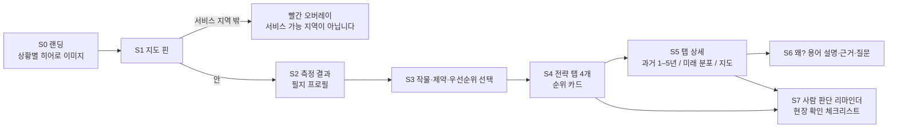
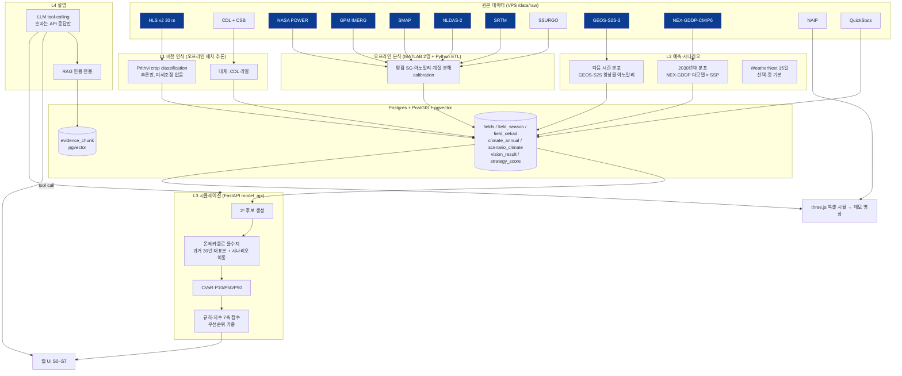
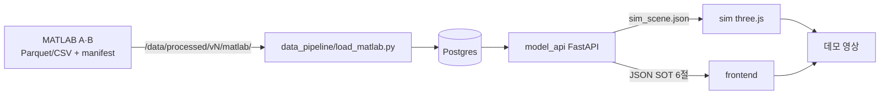

# TEAM_SPEC · 팀 작업 명세 (v1)

팀 **아몰라** · NASA Space Apps 2026 · 챌린지 07 *Field Shift: Adapting Farms with NASA Data* · 저장소 `cloudsnuchoi/2026NASA`  
작성 **2026-11-15 08:20 KST (Asia/Seoul)**. 마감 **2026-11-15 23:59 KST**.  
입력: 팀 아이디에이션·UIUX·디자인 PDF(14쪽), 챌린지 07 원문, [PRD.md](./PRD.md), [SOT.md](./SOT.md), [DECISIONS.md](./DECISIONS.md), 내부 메모 `fieldshift_context_v3.md`·`fieldshift_data_pipeline.md`.

> 이 문서는 **누가 무엇을 어떤 형식으로 넘기는지**를 고정한다. 필드명·단위·엔드포인트의 최종 원본은 [SOT.md](./SOT.md)다. 둘이 다르면 SOT가 이기고, 이 문서를 PR로 고친다.  
> 표기: `잠금` = 바꾸지 않음 · `열림` = 11:00 데이터 검증 스파이크 뒤 확정 · `미확인` = 웹에서 확인하지 못함 · `제안` = Hylē 확정 필요.

---

## 0. 한눈에

| 항목 | 내용 |
| --- | --- |
| 한 줄 제품 | 콘벨트 옥수수–대두 농가가 **지도에 핀을 찍으면**, NASA 위성·기후 자료로 그 밭의 과거 상태를 보여 주고, 윤작에 **무엇을 더하거나 바꿀지** 4개 전략을 토양 건강·물·회복력·소득 축으로 비교해 주는 **판단 보조 도구** |
| 영문 한 줄 | *Drop a pin on a Corn Belt field, see what NASA data says about its past and possible futures, and compare rotation changes that may improve soil health and resilience to weather and water — a support tool, not a replacement for farmer judgment.* |
| AI 4층 | (1) 비전 인식 Prithvi → (2) 예측·시나리오 GEOS-S2S·NEX-GDDP-CMIP6 → (3) 시뮬레이션 몬테카를로 물수지 + CVaR + 규칙·지수 점수 → (4) LLM 설명(tool-call) + RAG(인용 전용) |
| 하지 않음 | 강화학습, 미세조정, 3년 결정론적 예보, LLM이 숫자 생성, SMAP·GRACE를 필지 정밀 값처럼 표시 |

---

## 1. 제품 정의: 잠긴 것과 열린 것

### 1.1 잠금 (2026-11-15 08:20 KST)

1. **대상.** 미국 콘벨트 옥수수–대두 농가와 그들을 돕는 현지 전문가. 본편 공간은 **아이오와 또는 일리노이 카운티 1곳**(빗물 농업). 카운티 이름은 스파이크에서 이슈 #1로 닫는다.
2. **돕는 결정.** “기존 윤작에 **어떤 작물을 추가하거나 바꾸면** 토양 건강이 좋아지고 날씨·물 변화에 더 잘 버틸까?” 정답을 명령하지 않고 선택지·트레이드오프·불확실성·정보 공백을 보여 준다.
3. **최소 산출.** 현재 윤작 포함 3–4개 전략 비교, 전략마다 이유·근거·이점·정보 공백·현지 검토 위험 (챌린지 07 원문 요구).
4. **AI 구성 원칙.** 위 4층. RL·미세조정 없음. 숫자는 모델 API만 만든다.
5. **미래 기후.** 3년 결정론적 예보를 보여 주지 않는다. 다음 시즌은 **GEOS-S2S** 계절 예보 분포, 2030년대는 **NEX-GDDP-CMIP6** 시나리오 분포로 보여 준다.

### 1.2 열림 (11:00 KST 스파이크 결과로 확정, 6절)

| # | 열린 항목 | 기본안 | 결정 기준 |
| --- | --- | --- | --- |
| O1 | 작물 선택 → 후보 생성 규칙 (팀 PDF의 “2ⁿ 경우”) | 2.3 기본안 | 팀 합의 + 데이터로 각 후보 점수가 나오는지 |
| O2 | 탭의 `%` 지표 정의(식생지수·물·연간 수익) | 기준 전략 A 대비 상대 변화, P10–P90 동반 | 각 축에 실제 입력 데이터가 있는지 |
| O3 | ET 출처 | NLDAS-2 Noah 증발산(맥락 칸) + POWER 기반 FAO-56 ET0 | 스파이크 3·5번 |
| O4 | Prithvi 비전 층 포함 여부 | 포함(보조), 실패 시 CDL 라벨 | 스파이크 8번 |
| O5 | GEOS-S2S 다음 시즌 패널 | 포함 | 스파이크 6번 파일 열림 여부 |
| O6 | 카운티 (IA vs IL) | 아이오와 후보 1개 + 일리노이 후보 1개 중 택1 | CSB·CDL C–S 비율, HLS 구름 |
| O7 | 수익 축 데이터 | QuickStats 카운티 수량 × 공개 가격 lite (상대 지수) | QuickStats 키 확보 여부 |

---

## 2. 사용자 흐름과 화면

팀 PDF 스케치(사이트 히어로, 농장 위치 입력, “서비스 가능 지역이 아닙니다” 빨간 오버레이, 필지 다각형, 측정 결과 팝업, 작물 선택 탭, 순위 카드 “B 물 절약 목표 / C 토양 건강 목표 / A 현재 방식”, 카드 아래 이미지 타임라인)를 그대로 따른다. 톤은 PDF 참고 이미지처럼 **밝은 농장 게임풍**(친근한 일러스트, 큰 숫자, 아이콘).



### 2.1 화면별 데이터 필드, 출처, API

모든 응답 필드명은 snake_case. 엔드포인트 계약은 SOT 6절에 추가했다(신규 표시 `NEW`).

| 화면 | 보여 줄 것 (필드) | 출처 데이터셋 | API |
| --- | --- | --- | --- |
| **S0 랜딩** | 사이트 이름, 한 줄 소개, 상황별 히어로 이미지(`hero_state` ∈ `normal`·`drought`·`wet`·`heat`·`frost`), 시작 버튼, 「판단을 대체하지 않음」 문구 | 히어로 상태는 S2 프로필의 최근 시즌 아노말리(POWER·IMERG·SMAP 맥락)에서 계산. 첫 진입 시 기본 `normal` | `GET /field/{id}/profile` 의 `hero_state` (핀 전에는 정적) |
| **S1 지도 핀** | 위성 배경 지도, 핀, 필지 다각형 하이라이트, 서비스 지역 밖이면 빨간 오버레이 | CSB 폴리곤(필지), 배경 타일(무료 위성 타일 또는 NAIP) | `GET /locate?lat=&lon=` `NEW` → `in_service_area`, `field_id`, `county_fips`, `state_alpha`, `area_ha`, `geometry` |
| **S2 측정 결과** (PDF 팝업 그대로) | 지역 라벨, 면적 `area_ha`(화면에서 m²·ha·평 동시 표기), 연 강수 `precip_mm_yr`, 증발산 `et_mm_day`, 식생지수 `ndvi_peak` + 등급(양호/보통/낮음), 평균기온 `t2m_mean_c`, **이전 작물 이력** `cdl_history[]`(연도·작물), 토양 요약 `soil{om_pct,k_factor,awc_cm_cm}`, 비전 인식 `vision{crop_pred,bare_periods,agreement_with_cdl}`, 버튼 “다시 측정 / 확인” | 강수: IMERG(또는 POWER) 30년 평년. ET: NLDAS-2 Noah(맥락 칸) / POWER→FAO-56 ET0. NDVI: HLS v2(30 m). 기온: POWER. 이력: CDL 2008–2025 + CSB 서열. 토양: SSURGO. 비전: Prithvi | `GET /field/{id}/profile` (확장) |
| **S3 작물·제약·우선순위** | (a) 현재 윤작 자동 채움(CDL로 추정, 수정 가능) (b) 추가 후보 선택 칩(최대 2–3개, O1) (c) 제약: 물 제한 여부·가용 물(mm), 장비, 시장 (d) 우선순위 슬라이더: 물 절약·토양 개선·안정/회복력·추가 소득 | 작물 특성 표(문헌: FAO-56 Kc, SARE, ISU Extension) | `POST /rotations/candidates` `NEW` → 후보 목록(2ⁿ)·실현 가능 플래그 |
| **S4 전략 탭 4개** | 탭마다: 순위, 목표 라벨(예: “물 절약 목표”), 윤작 서열(예: `C-S-W`), **기준 A 대비 %**: `vegetation_pct`·`water_use_pct`·`revenue_pct`(각 P10/P50/P90), **장점 3개(탭끼리 겹치지 않게)**, 단점 ≥1, 이 선택만의 특징 `unique_feature`, 7축 지수, CVaR, 카드 5항목(why·evidence·benefits·info_gaps·local_review_risks). 물 제한이면 물 가중치를 올렸다는 배지 | MC 물수지(POWER·IMERG·NLDAS·SSURGO·Kc), 규칙·지수 점수, QuickStats 수량, 가격 lite, RAG 인용 | `POST /strategies/compare` (확장) |
| **S5 탭 상세** | **과거(1–5년)**: 연도별 강수·ET·NDVI·기온·그해 작물(CDL)·NAIP 썸네일 / **다음 시즌**: GEOS-S2S 강수·기온 아노말리 분포(앙상블 P10–P90 또는 3분위 확률) / **2030년대**: NEX-GDDP-CMIP6 SSP2-4.5·SSP5-8.5 여러 모델의 변화 분포 / 이 전략의 시나리오별 물수지·CVaR / 맨땅 기간·취약 계절 / 필지 지도(침식·물 스트레스·서리) | POWER, IMERG, NLDAS-2, HLS, CDL, NAIP, GEOS-S2S, NEX-GDDP-CMIP6, SRTM, SSURGO | `GET /field/{id}/climate/history?years=5` `NEW`, `GET /field/{id}/climate/outlook` `NEW`, `GET /field/{id}/bare-periods`, `GET /field/{id}/vulnerable-seasons`, `GET /maps/{field_id}/{layer}` |
| **S6 왜? 용어·근거·질문** | 용어 카드(증발산, 토양수분 아노말리, NDVI, 서리 위험, 물수지, CVaR, 피복작물, 질소 고정, 심근 작물, 위성 vs 지상 관측), 전략별 “왜 이 작물이 맞을 수 있나” 설명, 출처 링크, 자유 질문 | 근거 카드(pgvector), 모델 API 숫자 | `GET /glossary` `NEW`, `GET /evidence/search`, `POST /explain` `NEW` (LLM tool-call) |
| **S7 사람 판단 리마인더** | 화면 하단 고정 문구 + 전략별 “현장에서 확인할 것” 체크리스트(토양검정, 지역 병해충, 장비, 계약·시장, 관개권) + 데이터 해상도 경고(SMAP·NLDAS·GEOS-S2S는 수–수십 km 칸) | 카드 `local_review_risks`, `info_gaps` | `POST /strategies/compare` 응답 재사용 |
| **(영상) 복셀 시뮬** | 필지 복셀 지형 위 계절별 작물·맨땅·토양수분·가뭄/폭우 이벤트 애니메이션, 전략 A vs B/C/D | `sim_scene.json`(아래 7.5), NAIP 텍스처, SRTM 고도 | `GET /sim/{field_id}/scene?strategy=` `NEW` (또는 정적 JSON 파일) |

### 2.2 화면 문구 규칙

- 모든 `%`는 **“기준 전략 A 대비 상대 지수 변화, 보장값 아님”** 툴팁과 P10–P90 범위를 같이 보여 준다. PDF 예시의 “물 사용 −20%, 연간 수익 +15%, 토양 유기물 +25%”는 **자리표시 디자인 숫자**이며, 실제 화면에는 모델 출력만 쓴다.
- 토양 유기물·질소는 kg 단위 확정값을 쓰지 않는다. 「현장 토양검정 후 확정」.
- 미래 패널 제목은 “예보”가 아니라 **“가능한 범위(시나리오)”**.

### 2.3 후보 생성 규칙 (팀 PDF의 “2ⁿ”) · 제안

팀 PDF: “농부가 옥수수·대두·밀 중 최대 2개를 고르면 2ⁿ 경우를 모두 계산, 2개면 탭 4개.” PRD 4전략(A–D)과 맞추기 위한 기본안:

1. **현재 윤작**은 CDL 이력에서 자동 추정(대개 `C-S`). 농부가 수정할 수 있다.
2. 농부는 **추가 요소** 중 n개(기본 최대 2, 확장 3)를 고른다: `cover_rye`(겨울 호밀 피복), `small_grain`(밀 또는 귀리), `alfalfa`(다년생 사료). 화면 라벨은 “옥수수/대두/밀/호밀 피복/알팔파” 칩.
3. 백엔드는 선택 요소의 **부분집합 2ⁿ개**를 모두 만든다. n=2면 4개 = 탭 4개(공집합이 기준 A).
   - 예: `cover_rye` + `small_grain` → `A`(C-S), `B`(C-S+호밀), `C0`(C-S-W), `C`(C-S-W+피복).
   - n=3이면 8개를 계산하고, A + “가장 잘하는 축이 서로 다른” 상위 3개를 탭으로 보여 준다(나머지는 “더 보기”).
4. 물 제한(`water_limited=true` 또는 `water_cap_mm`)이면 물 축 가중치를 올리고, 물 수요가 상한을 넘는 후보(예: 알팔파)는 **숨기지 않고** 경고 배지를 단다.
5. 기본 데모 선택은 `cover_rye` + `small_grain`(빗물 아이오와) 그리고 `alfalfa`를 넣은 3선택 화면 한 컷.

이 규칙은 O1로 11:00에 팀이 확정한다. 확정 전까지 API는 PRD의 A–D 고정 4개를 반환해도 계약 위반이 아니다.

---

## 3. 챌린지 07 요구 → 기능 추적표

원문: `challenges_raw/07-adapting-farms-with-nasa-data.md` (Objectives + Potential Considerations).

| 07 요구(원문 요지) | 우리 기능 | 화면 | 우선 |
| --- | --- | --- | --- |
| NASA 지구관측 + 현지 토양·작물 특성 + 농가 우선순위로 윤작 전략 탐색 | 전체 흐름, 슬라이더, SSURGO, 작물 특성 표 | S2–S4 | P0 |
| 온도·열 스트레스·강수·토양수분·증발·서리·극한강수·식생 스트레스·장기 물 추세 패턴 | 취약 계절, 과거 1–5년, 30년 평년 아노말리, GRACE 맥락(선택) | S2, S5 | P0 (GRACE P1) |
| 물 사용, 사료 가치, 질소 고정, 침식 감소, 유기물, 시장 적합성 | 7축 지수(n_cycle, erosion, organic_matter, pest_break, water_use, forage, market) | S4 | P0 |
| 맨땅 시기, 취약 계절, 병해충 주기 차단·물 수요 감소·침투 개선·추가 소득 기회 | 맨땅 기간(HLS/Prithvi/CDL), 취약 계절, 카드 장점 3개 | S2, S4, S5 | P0 |
| 기존 윤작 포함 **3개 이상** 전략 비교 | 탭 4개(A 포함) | S4 | P0 |
| 전략마다 why·evidence·benefits·gaps·local-review risks | 카드 5항목 (생략 금지) | S4, S6, S7 | P0 |
| 농부 판단을 대체하지 않는 지원 도구 | 고정 문구, 체크리스트 | S0, S7 | P0 |
| 증발산·토양수분 아노말리·NDVI·서리 위험·물수지 용어 설명 | 용어 카드 | S6 | P0 |
| 위성 vs 지상 관측 차이와 결합 | 용어 카드 + 데이터 출처 배지(IMERG vs PRISM/CoCoRaHS 비교 1장) | S6 | P1 |
| SI·통계 접근 비교 | MATLAB에서 평활(Savitzky–Golay vs 이동평균)·아노말리 방법 비교 그림 1장 | 발표·README | P1 |
| SI로 계절 전환·맨땅·스트레스 시기 강조 | Prithvi 비전 + NDVI 평활 | S2, S5 | P0(CDL 대체 가능) |
| 불확실성 해석, 현지 전문가 검증 지점 | P10/P50/P90, CVaR, 시나리오 분포, info_gaps | S4, S5, S7 | P0 |
| 해상도 조화(공통 격자) | 2단 격자(필지 30 m / 맥락 칸), MATLAB 산출 스키마 | 백엔드 | P0 |
| 질소 고정·피복·심근·가뭄 내성 작물이 토양 건강에 기여하는 방식 | 전략별 “왜 이 작물?” + RAG 인용 | S6 | P0 |
| 우선순위별 정렬(물 절약, 추가 소득, 토양 구조) | 슬라이더 + 물 제한 가중치 | S3, S4 | P0 |
| 인터랙티브 지도로 장기 추세 탐색 | 지도 레이어 + 과거 타임라인 | S1, S5 | P1 |
| 필지 단위 취약 구역(침식·물 스트레스·서리) | `/maps/{field_id}/{layer}` | S5 | P1 (침식 P0 목표) |
| 타임라인·오버레이·강수/기온 시나리오 슬라이더 | 과거 타임라인(P0), 시나리오 슬라이더(GEOS-S2S/NEX 분위 선택, P1) | S5 | P0/P1 |
| 비전문가도 쉽게 | 게임풍 UI, 히어로 이미지, 큰 숫자, 용어 카드 | 전체 | P0 |
| 우선순위·제약 입력(물·장비·시장) | S3 입력 | S3 | P0 |

---

## 4. NASA·외부 데이터 → 기능 매핑

### 4.1 공식 Resources 27행 (Resources 24항목·링크 26개 + Details의 GRACE/GRACE-FO)

`P0` = 본편 계산에 필수 · `P1` = 시간 되면 · `컷` = 이번 주말 미사용(한국·서부 전용 등).

| # | 데이터 | 쓰는 기능 | 우선 |
| --- | --- | --- | --- |
| 1 | SMAP | 토양수분 아노말리(맥락 칸), 히어로 상태, 취약 계절 | P0 (맥락만) |
| 2 | GPM IMERG | 강수 평년·극한강수 빈도, MC 강수 표본 검증 | P0 |
| 3 | Landsat 8/9 (HLS로 사용) | 필지 NDVI, 맨땅 기간, Prithvi 입력 | P0 |
| 4 | MODIS | 2000년~ 지역 NDVI 평년(HLS 공백 보완) | P1 |
| 5 | VIIRS | MODIS 연속성 | 컷 |
| 6 | NASA POWER | 일 기온·강수·일사 → FAO-56 ET0, 서리·폭염 일수, MC 기후 표본(1981~) | P0 |
| 7 | SRTM | 경사 → 침식 지수(RUSLE LS 근사), 복셀 지형 | P0 |
| 8 | ECOSTRESS | 필지 열·물 스트레스 보조 증거(장면 있을 때만) | P1 |
| 9 | USDA Ag Data Commons | 작물 특성 근거 후보 | P1 |
| 10 | Web Soil Survey | 데모 필지 토양 확인(사람) | P1 |
| 11 | CDL (CropScape) | 이전 작물 이력, 현재 윤작 추정, Prithvi 대체 라벨, 백테스트 | P0 |
| 12 | PRISM | IMERG·POWER 검증(위성 vs 지상 비교 1장) | P1 |
| 13 | SSURGO / STATSGO2 | 유기물, K 인자, AWC → 침식·물수지 | P0 |
| 14 | **NAIP** | 과거 1–5년 썸네일, 복셀 시뮬 텍스처·영상 | P0 (영상), P1 (앱 썸네일) |
| 15 | NLCD | 농지 마스크 | 컷 (CDL로 대체) |
| 16 | **NLDAS / GLDAS** | NLDAS-2 Noah 증발산·근권 토양수분 연속 시계열(SMAP 보완), GLDAS는 미국 밖 대체 | P0 (NLDAS-2) / 컷 (GLDAS) |
| 17 | FAO GAEZ | 미국 밖 적합성 | 컷 |
| 18 | CoCoRaHS | 강수 지상 검증 | P1 |
| 19 | USGS NWIS | 관개 맥락 | 컷 (빗물 본편) |
| 20 | USDA AMS Market News | 가격 lite(시장 적합성) | P1 |
| 21 | USDA NASS QuickStats | 카운티 수량·면적 → 수익 상대 지수, 2012 백테스트 | P0 |
| 22 | OpenET | ET 교차검증 | P1 |
| 23 | LANDFIRE | 경관 맥락 | 컷 |
| 24 | GEDI | 바이오매스 맥락 | 컷 |
| 25 | Sentinel-2 (HLS S30로 사용) | HLS 밀도 보강 | P0 (HLS 안에서) |
| 26 | ERA5 | POWER 교차검증 | 컷 |
| 27 | GRACE / GRACE-FO | 유역 물 저장량 추세(맥락 문장 1줄) | P1 |

P0의 NASA 산출물: **POWER, IMERG, SMAP, HLS(Landsat/Sentinel-2), SRTM, NLDAS-2** (+ 외부 NASA: GEOS-S2S, NEX-GDDP-CMIP6, Prithvi).

### 4.2 Resources 밖 자료 (제출 Other Data·References에 반드시 기재)

| 데이터·모델 | 기관 | 기능 | 우선 | 확인한 접근 경로 (2026-11-15 KST 확인) |
| --- | --- | --- | --- | --- |
| HLS v2 `HLSL30`/`HLSS30` | NASA LP DAAC | NDVI, Prithvi 입력 | P0 | CMR 확인: v2.0, LPCLOUD, L30 2013-04-11~, S30 2015-11-28~ |
| NLDAS-2 `NLDAS_NOAH0125_H`/`_M`, `NLDAS_FORA0125_H` | NASA GES DISC | ET·토양수분·기상 | P0 | CMR 확인 v2.0, 1979~. DOI 10.5067/T4OW83T8EXDO (Noah 시간). NLDAS-3는 forcing만 AWS 베타 |
| **GEOS-S2S-3** | NASA GMAO | 다음 시즌 강수·기온 분포 | P0 | `https://portal.nccs.nasa.gov/datashare/gmao/geos-s2s-3/NRT/APCN/202611/` 에 `202611_precip.tar.xz`, `202611_at.tar.xz` 등 공개 목록 확인. `Hindcast/` 폴더 있음. 0.5° 격자, 월 40멤버(GMAO 시스템 설명) |
| **NEX-GDDP-CMIP6** | NASA NCCS | 2030년대 시나리오 분포 | P0 | `s3://nex-gddp-cmip6/` (us-west-2, AWS Open Data) 및 NCCS THREDDS NCSS 부분 추출. 0.25° 일, CC0(2022-09~) |
| **Prithvi** 작물 분류 체크포인트 | NASA·IBM | 작물·맨땅 인식(비전 층) | P0(보조) | `ibm-nasa-geospatial/Prithvi-EO-1.0-100M-multi-temporal-crop-classification` (Apache-2.0) — 5.3 |
| CSB Crop Sequence Boundaries | USDA NASS | 필지 폴리곤·작물 서열 | P0 | SOT 1.1 |
| WeatherNext (선택) | Google DeepMind | 15일 작업 창(파종·수확·살포) | 컷 기본 | 접근 신청 승인 5–7 영업일 → 마감 전 불가 가능성 큼 |
| 문헌(SARE, ISU Extension, MCCC, FAO-56) | 각 기관 | 작물 특성, 근거 카드 | P0 | URL·DOI만 저장 |

---

## 5. AI 4층 아키텍처



### 5.1 층별 역할과 경계

| 층 | 무엇을 | 입력 → 출력 | 하지 않는 것 |
| --- | --- | --- | --- |
| L1 비전 | HLS 3시점 칩 → 작물·맨땅 픽셀 분류, 필지 다수결 | HLS L30/S30 6밴드 × 3시점 → `vision_result` | 미세조정, 실시간 추론(요청 경로 GPU 없음) |
| L2 예측·시나리오 | 다음 시즌 강수·기온 아노말리 분포, 2030년대 변화 분포 | GEOS-S2S, NEX-GDDP → `scenario_climate` | 결정론적 3년 예보, 필지 해상도 주장 |
| L3 시뮬레이션 | 2ⁿ 후보 × (과거 30년 재표본 + 시나리오 이동) 물수지 MC → CVaR, 7축 지수, 기준 A 대비 % | DB 피처 → `/strategies/compare` | 단일 최적해 강제, 확정 kg/ha |
| L4 설명 | 사용자 질문 → 모델 API tool call → 숫자 인용 설명 + RAG 출처 | API JSON + evidence_chunk → 텍스트 | 숫자 생성·수정, 근거 없는 주장 |

### 5.2 MC 물수지 최소 규격 (L3)

- 표본: POWER 일 기후 1991–2020(또는 적재된 최대 창)에서 **연 단위 재표본** N=1000(데모 기본 500).
- 시나리오 이동: 다음 시즌은 GEOS-S2S 앙상블 아노말리(월 강수 비율, 기온 차)를 표본에 더함. 2030년대는 NEX-GDDP 모델별 기간 평균 변화(delta)를 적용(delta method).
- 물수지: 일 단위 `토양수분 = 이전 + 강수 − ETc − 유출/배수`, ETc = ET0(FAO-56, POWER) × Kc(작물·생육 단계 문헌 범위), 용량 = SSURGO AWC × 근권 깊이.
- 출력: 전략별 생육기 물 부족(mm), 스트레스 일수, 겨울 맨땅 일수 → P10/P50/P90, **CVaR(하위 10%)**.
- 이 규격은 Python(NumPy) 구현. MATLAB은 계수 보정 결과를 `calibration_params.csv`로만 넘긴다.

### 5.3 비전 층: Prithvi 사실 확인

2026-11-15 KST에 Hugging Face API(`/api/models?author=ibm-nasa-geospatial`)로 확인한 공식 체크포인트:

| 체크포인트 | 종류 | 작물 분류에 쓸 수 있나 |
| --- | --- | --- |
| `Prithvi-EO-2.0-tiny-TL`, `-100M-TL`, `-300M`, `-300M-TL`, `-600M`, `-600M-TL` | 사전학습 백본만 | **아니오** (분류 헤드 없음 → 미세조정 필요) |
| `Prithvi-EO-2.0-300M-TL-Sen1Floods11`, `Prithvi-EO-2.0-300M-BurnScars` | 홍수·화재 흔적 미세조정 | 아니오 |
| **`Prithvi-EO-1.0-100M-multi-temporal-crop-classification`** | HLS + CDL로 미세조정된 **미국 작물 13클래스** 분할 (옥수수, 대두, 겨울밀, 알팔파, 휴경 등) | **예** — 입력 224×224×18 (6밴드 × 3시점), 파일 `multi_temporal_crop_classification_Prithvi_100M.pth`, Apache-2.0, DOI 10.57967/hf/0954 |

- 따라서 “Prithvi-EO-2.0 공개 미세조정 작물 체크포인트”는 **존재하지 않는다**. 미세조정 금지 결정을 지키려면 **Prithvi-EO-1.0 작물 분류 체크포인트로 추론만** 한다([DECISIONS.md](./DECISIONS.md) 정정 기록).
- 모델 카드의 성능: aAcc 60.64 %, mIoU 0.4269 (옥수수 IoU 0.549, 대두 0.530). CDL 라벨 잡음이 있다고 카드가 명시. → 화면에서는 **보조 인식**이고 기준은 CDL. `agreement_with_cdl`을 같이 보여 준다.
- 원 학습 코드는 mmsegmentation 기반(`hls-foundation-os`), 카드 `library_name`은 terratorch. 현재 터라토치로 바로 로드되는지는 **미확인** → 스파이크 8번.

### 5.4 LLM·RAG

- LLM 도구: `get_profile`, `compare_strategies`, `get_climate_history`, `get_outlook`, `search_evidence`. 답변의 모든 숫자는 도구 응답 JSON 경로를 각주로 단다.
- RAG: `evidence_chunk`(pgvector)에서 짧은 인용 + DOI/URL만. 근거가 없으면 `insufficient_evidence: true`이고 문장을 만들지 않는다.
- 공급자·모델명·임베딩 차원은 `infra/.env.example`과 SOT 7절에 기록(현재 미정).

---

## 6. 데이터 검증 스파이크 (09:00–11:00 KST, 2시간)

목적: “우리가 화면에 약속하는 숫자를 실제 데이터로 1개 필지에 대해 만들 수 있나?”를 확인하고 11:00에 기능을 잠근다. 결과는 이슈의 체크박스와 `docs/spike_report.md`(짧게)로 남긴다.

| # | 확인 | 담당(제안) | 통과 기준 (Go) | 실패 시 (No-go → 대체) |
| --- | --- | --- | --- | --- |
| 1 | 카운티 후보 2곳(IA 1, IL 1)에서 CSB 폴리곤 + CDL 2008–2025 서열 | 백엔드 | 필지 ≥ 100개 중 C–S 교대 비율이 높은 카운티 1곳 선택, 데모 필지 `field_id` 3개 확보 | CDL 래스터만으로 30 m 픽셀 다수결 필지 |
| 2 | 핀 → 필지 조회 | 백엔드 | 좌표 1개로 `field_id`·`area_ha` 반환 (PostGIS 또는 GeoPandas) | 데모 필지 3개 하드코딩 + 서비스 지역 다각형 |
| 3 | NASA POWER 일자료 1991–2025 | MATLAB A | 결측 < 1 %, 단위 확인, 응답 메타 해상도 기록 | IMERG + PRISM으로 대체 |
| 4 | HLS NDVI 한 필지 1년(4–11월) | MATLAB B / 백엔드 | 구름 마스크 후 유효 장면 ≥ 8, 맨땅 → 출현 → 수확 전환이 보임 | MODIS 250 m NDVI(맥락) + CDL 라벨 |
| 5 | SMAP L3 + NLDAS-2 Noah 토양수분·증발산 | MATLAB A | 같은 칸 월 시계열이 2015–2025 연속, ET 단위 변환 확인 | NLDAS만 (SMAP은 문장 맥락) |
| 6 | **GEOS-S2S** `202611_precip.tar.xz`, `202611_at.tar.xz` | 백엔드 / MATLAB A | 압축 해제 후 격자·변수·멤버·리드 월 확인, 아이오와 칸의 2027 MAM·JJA 값 추출 | Hindcast 기후값 대비 아노말리 불가면 → 패널을 “과거 30년 분포(기후값)”로 대체하고 문구 변경 |
| 7 | **NEX-GDDP-CMIP6** 3개 모델 × SSP2-4.5/5-8.5 × `pr`,`tasmax`,`tasmin` 2031–2040 + historical 1985–2014 | MATLAB B | THREDDS NCSS로 칸 추출 성공, delta 계산 | 모델 1개만 (불확실성 문구 강화) |
| 8 | **Prithvi** 작물 체크포인트 추론 | 백엔드(Colab T4 또는 VPS CPU) | 3시점 HLS 칩 1장 추론, CDL과 픽셀 일치율 기록(목표 ≥ 50 %) | 비전 층을 CDL 라벨로 대체하고 발표에서 “다음 단계”로 |
| 9 | NAIP 데모 필지 타일 | 시뮬 담당 | Planetary Computer STAC로 2017·2019·2021·2023·2025 중 ≥ 3시점 | 위성 배경 타일 스크린샷 |
| 10 | SSURGO 유기물·K·AWC | 백엔드 | Soil Data Access 쿼리로 데모 필지 mapunit 값 | 카운티 대표값 |
| 11 | QuickStats 옥수수·대두 카운티 수량 2008–2025, 2012 포함 | Hylē | API 키로 카운티 행 확보 | 주 단위 수량 |

**11:00 결정 회의(10분).** Go 항목 수로 기능 잠금: 1·2·3·4·11이 Go면 P0 흐름 확정. 6·7 결과로 S5 미래 패널 형태 확정. 8 결과로 L1 포함 여부 확정. 결과를 DECISIONS.md에 기록하고 PRD를 PR로 갱신.

---

## 7. 역할과 인계 계약

### 7.1 역할 슬롯 (6명)

| 슬롯 | 인원 | 산출물 | 폴더 |
| --- | --- | --- | --- |
| 오케스트레이터·PM | Hylē | 이슈 배분, 리뷰·머지, 결정 기록, 모니터링 다이제스트, 통합, 제출 | `docs/`, `infra/` |
| MATLAB 데이터 처리·분석 A | 1명 | 기후·토양수분 계열: POWER·IMERG·SMAP·NLDAS·GEOS-S2S 칸 추출, 아노말리, `climate_annual`, `field_season`, `scenario_climate`(S2S) | `matlab/climate/` |
| MATLAB 데이터 처리·분석 B | 1명 | 식생·시나리오 계열: HLS NDVI 평활(SG), 맨땅 탐지, `field_dekad`, NEX-GDDP delta, 방법 비교 그림 | `matlab/vegetation/`, `matlab/scenario/` |
| three.js 복셀 시뮬 | 1명 | `sim/` 정적 HTML, `sim_scene.json` 소비, 데모 영상 소스 | `sim/` |
| UI/UX A | 1명 | S0–S3 화면, 디자인 시스템(게임풍), 지도 | `frontend/` |
| UI/UX B | 1명 | S4–S7 화면, 카드·차트·용어 카드, 발표 슬라이드 디자인 | `frontend/`, `pitch/` |

**확정 (2026-11-15 09:30 KST).**

| 슬롯 | 이름 | Mattermost |
| --- | --- | --- |
| 오케스트레이터·PM + **풀스택(백엔드·API·DB·RAG·인프라·배포)** | Hylē | `hyle` |
| MATLAB A (기후·토양수분) | 김윤성 | `yoonsung` |
| MATLAB B (식생·시나리오) | 김우찬 | `woochan` |
| UI/UX A (S0–S3) | 고지은 | `jieun` |
| UI/UX B (S4–S7, 슬라이드 디자인) | 하지민 | `jimin` |
| three.js 복셀 시뮬·데모 영상 | 강다은 (**확인 필요**) | `daeun` |

### 7.2 백엔드 담당 (해소)

7.2의 공백은 **안 B로 해소**됐다. Hylē가 Codex/agy 에이전트와 함께 모델 API, DB 적재, MC·CVaR, LLM/RAG, Prithvi 추론, 배포를 맡는다. 과부하를 줄이려고 지시·피드백은 Mattermost 오케스트레이터 봇(`infra/orchestrator/`)이 1:1 채널에서 대신한다. 팀원은 봇이 준 프롬프트를 Codex/agy에 붙여 넣는다([PROMPTS.md](PROMPTS.md), [ONBOARDING.md](ONBOARDING.md)).

### 7.3 인계 흐름



### 7.4 MATLAB → DB 계약 (고정)

공통 규칙:

- 위치: VPS `/data/processed/v{N}/matlab/{file}`. 같은 버전 덮어쓰기 금지, 스키마가 바뀌면 `v{N+1}`.
- 형식: **Parquet**(`parquetwrite`, MATLAB R2019a+) 우선, 안 되면 **CSV UTF-8, 쉼표, 헤더 1줄, 소수점 `.`**, 결측은 빈칸(0으로 채우지 않음).
- 컬럼명 snake_case, 단위는 SOT 2절. 날짜 `YYYY-MM-DD`. `field_id`는 문자열.
- 파일마다 옆에 `{file}.manifest.json`: `{"file","rows","sha256","schema_version","matlab_version","script","git_commit","created_kst","sources":[...]}`.
- 스크립트는 `matlab/` 아래 커밋. 원본 데이터 경로는 환경 변수 `FS_DATA_ROOT`.
- 적재는 Python `data_pipeline/load_matlab.py`(백엔드). MATLAB은 DB에 직접 쓰지 않는다.

| 파일 | 담당 | 키 | 컬럼 (단위) | 적재 테이블 |
| --- | --- | --- | --- | --- |
| `field_dekad.parquet` | B | `field_id, year, dekad` | `date_start`(date), `ndvi_raw`(무차원), `ndvi_sg`(SG 평활), `n_obs`(int), `bare_flag`(bool), `precip_mm`, `et0_mm`, `t2m_c`, `sm_anom_ctx`(맥락 칸), `qa_flag`(text) | `field_dekad` |
| `field_season.parquet` | A | `field_id, year, season` | SOT `field_season` 컬럼 그대로 | `field_season` |
| `climate_annual.parquet` | A | `field_id, year` | `precip_mm`, `et_mm`(실제 ET, NLDAS), `et0_mm`, `t2m_mean_c`, `ndvi_peak`, `gdd_c`(기준 10 °C), `frost_days`(tmin<0), `heat_days`(tmax>32 °C), `crop_cdl`(text), `source_ids`(text, `;` 구분) | `climate_annual` |
| `scenario_climate.parquet` | A(S2S)·B(NEX) | `field_id, horizon, source_id, scenario, model, member, variable, period` | `horizon` ∈ `next_season`·`2030s`, `source_id` ∈ `geos_s2s`·`nex_gddp`, `scenario` ∈ `forecast`·`ssp245`·`ssp585`, `model`(text), `member`(text, 없으면 `mean`), `variable` ∈ `pr`·`tas`·`tasmax`·`tasmin`, `period`(예 `2027-JJA`, `2031-2040`), `value`, `unit`, `baseline_period`, `anomaly`(value − baseline), `anomaly_unit` | `scenario_climate` |
| `calibration_params.csv` | A·B | `param` | `value`, `unit`, `method`, `source`, `notes` | `calibration_param` |
| `method_compare.png` + `.csv` | B | — | 평활·아노말리 방법 비교(발표·README용) | DB 안 함 |

임계값(32 °C 등)은 기본안이며 SOT에 고정. 바꾸려면 PR.

### 7.5 API → UI, API → 시뮬 계약

- UI는 **SOT 6절 예시 JSON**으로 먼저 개발한다. 백엔드는 11:30까지 `model_api/fixtures/*.json`(SOT 예시와 동일)을 내놓고, UI는 `VITE_API_BASE`가 비어 있으면 fixture를 읽는다.
- 시뮬은 `sim_scene.json`만 읽는다(스키마 SOT 6절 `GET /sim/{field_id}/scene`). 14:00까지 fixture 1개, 17:00까지 실제 데이터 1개.

```json
{
  "schema_version": "1",
  "field_id": "CSB-EXAMPLE-0001",
  "strategy_code": "B",
  "grid": { "nx": 64, "ny": 64, "cell_m": 10, "elevation_m": "[[...]]" },
  "texture": { "naip_url": "https://...", "year": 2023 },
  "frames": [
    { "date": "2026-11-01", "season": "fall", "cover": "cereal_rye", "bare": false,
      "ndvi": 0.31, "soil_moisture_rel": 0.42, "event": null }
  ],
  "events": [{ "date": "2012-07-15", "type": "drought", "label": "2012 drought" }],
  "sources": ["HLS", "CDL", "SRTM", "NAIP", "POWER"]
}
```

---

## 8. 역할별 Codex CLI / Gemini CLI(agy) 사용법

공통:

1. 각자 노트북에서 `gh auth login` → `git clone https://github.com/cloudsnuchoi/2026NASA` → 자기 이슈 브랜치 `feat/<#>-slug`.
2. **Codex CLI**는 저장소 루트 `AGENTS.md`를 자동으로 읽는다. **Gemini CLI(agy)**는 `GEMINI.md`를 읽으므로, 루트 `GEMINI.md`가 `AGENTS.md`를 가져오도록 해 두었다.
3. 프롬프트 첫 줄은 항상: “`AGENTS.md`, `docs/SOT.md`, `docs/TEAM_SPEC.md`를 읽고, 이슈 #N 범위만 작업해.”
4. 에이전트가 SOT에 없는 필드·엔드포인트를 만들려 하면 중단하고 이슈에 제안 댓글.
5. 비밀값은 `.env`(커밋 금지). 큰 데이터는 VPS.
6. 두 CLI 분업 권장: **Codex = 코드 작성·테스트·리팩터**, **Gemini = 긴 문서·데이터 사용자 가이드 읽기·요약, 대안 검토**. 같은 파일을 두 에이전트가 동시에 고치지 않는다.

| 역할 | Codex 프롬프트 시작 예 | Gemini(agy) 프롬프트 시작 예 |
| --- | --- | --- |
| Hylē (PM) | “`gh issue list`와 `gh pr list` 결과를 보고 TEAM_SPEC 10절 타임라인 대비 지연 이슈와 막힌 PR을 표로 정리해.” | “`docs/DECISIONS.md`와 오늘 머지된 PR을 읽고 PRD에 반영해야 할 변경을 diff 제안으로 써.” |
| MATLAB A | “`matlab/climate/power_fetch.m`을 작성해. NASA POWER daily point API로 1991–2025 T2M, T2M_MAX, T2M_MIN, PRECTOTCORR, ALLSKY_SFC_SW_DWN을 받아 TEAM_SPEC 7.4 `climate_annual` 스키마로 parquetwrite 하고 manifest.json을 남겨.” | “GEOS-S2S-3 primer PDF와 APCN 압축 파일 구조를 읽고, 아이오와 칸 강수·기온 앙상블을 뽑는 절차를 단계별로 정리해.” |
| MATLAB B | “`matlab/vegetation/ndvi_sg.m`: HLS NDVI 시계열을 Fmask로 거르고 Savitzky–Golay로 평활, dekad 집계, bare_flag 규칙을 적용해 `field_dekad.parquet`로 저장해. 임계값은 파라미터로.” | “NEX-GDDP-CMIP6 tech note를 읽고 THREDDS NCSS로 3개 모델 pr/tasmax/tasmin 칸을 받는 URL 목록과 delta 계산식을 만들어.” |
| 백엔드 | “`model_api/`에 FastAPI 앱을 만들고 SOT 6절 엔드포인트를 fixture로 먼저 응답하게 해. pydantic 모델과 계약 테스트 포함.” | “Prithvi-EO-1.0 crop classification 모델 카드와 hls-foundation-os 추론 스크립트를 읽고 CPU/Colab T4 추론 절차를 정리해.” |
| UI/UX A | “`frontend/`에 Vite+React+TypeScript로 S0–S3를 만들어. 지도는 MapLibre GL, 서비스 지역 밖이면 빨간 오버레이. API가 없으면 `fixtures/`를 읽어.” | “팀 PDF 스케치 설명(TEAM_SPEC 2절)을 바탕으로 게임풍 디자인 토큰(색·폰트·카드 그림자)을 제안해.” |
| UI/UX B | “S4 전략 탭 4개를 만들어. 카드: 순위, 목표 라벨, 기준 A 대비 % 3개(P10–P90 막대), 장점 3·단점, unique_feature, 카드 5항목 접기.” | “TEAM_SPEC 2.1 S6 용어 10개를 농부 눈높이 한국어·영어 2문장씩으로 써. 숫자 없이.” |
| 복셀 시뮬 | “`sim/index.html`에 three.js InstancedMesh 복셀 필지를 만들고 `sim_scene.json` frames를 타임라인으로 재생해. 전략 A/B 분할 화면.” | “30초 영상 콘티: 2012 가뭄 → 맨땅 겨울 → 호밀 피복 전략 비교, 장면별 자막(영어) 초안.” |

---

## 9. 오케스트레이션과 모니터링

> **09:30 KST 갱신:** 1:1 지시는 Mattermost 오케스트레이터 봇이 맡는다([infra/orchestrator/README.md](../infra/orchestrator/README.md), DECISIONS 09:30). GitHub는 여전히 유일한 상태 저장소다. 봇은 읽기만 한다.

**원칙.** GitHub가 유일한 상태 저장소다. 무거운 중앙 오케스트레이터 에이전트(사람에게 실시간 지시하는 자율 에이전트)는 만들지 않는다. 16시간 안에 그것을 만들고 디버깅하는 비용이 이득보다 크고, 사람 6명은 이미 각자 에이전트를 쓴다.

| 장치 | 내용 | 주기 |
| --- | --- | --- |
| 이슈 = 작업 카드 | 담당자 1명, 라벨 `area:*`·`priority:*`, 체크박스 하위 작업, 예상 시간 | 상시 |
| 상태 표기 | 시작 시 이슈에 “started” 댓글 + 브랜치 push, 막히면 `blocked` 라벨 + 이유 | 상시 |
| PR | 이슈 1개 = PR 1개, 리뷰 1명, squash merge | 상시 |
| **모니터링 다이제스트** | `infra/monitor/digest.sh`(읽기 전용 `gh` 질의): 담당자별 열린 이슈, 60분 넘게 업데이트 없는 진행 중 이슈, blocked, 열린 PR·리뷰 대기, 지난 주기 머지 목록 → 마크다운. Hylē가 확인 후 팀 채팅에 붙이거나 NASA 봇이 요약 | **30–60분** (14:00 이후 30분) |
| 싱크 | 매시 정각 10분 스탠드업: 어제→지금→막힘 | 매시 |
| 결정 | DECISIONS.md에 시각(KST)과 함께 | 결정 즉시 |
| Projects 보드 | 권한(`project` scope) 생기면 이슈를 보드에 추가 | 선택 |

---

## 10. 타임라인 (KST, 2026-11-15)

| 시각 | 할 일 | 산출물 / 게이트 |
| --- | --- | --- |
| 08:20–09:00 | TEAM_SPEC 읽기, 역할·백엔드 공백 결정, 계정·키(Earthdata, QuickStats, LLM) 준비 | 역할 확정 기록 |
| **09:00–11:00** | **데이터 검증 스파이크** (6절) + UI는 fixture로 S0–S2 골격, 시뮬은 fixture 복셀 | 스파이크 리포트 |
| 11:00 | **기능 잠금 회의** (O1–O7 닫기) | DECISIONS·PRD 갱신 |
| 11:00–14:00 | MATLAB 1차 산출(v1 파일 3개), API 실제 DB 연결 시작, UI S3–S4, 시뮬 fixture 재생 | 11:30 API fixture, 13:00 MATLAB v1 |
| 14:00 | **통합 체크포인트 1**: UI ↔ API(fixture) 전체 클릭, 시뮬 fixture | 끊긴 곳 이슈화 |
| 14:00–17:00 | MC·CVaR 실데이터, 시나리오 패널, LLM tool-call·RAG, Prithvi 배치 결과 적재, S5–S7 | |
| 17:00 | **통합 체크포인트 2**: 실데이터 1필지 end-to-end, 시뮬 실데이터 1개 | |
| 18:00–20:00 | **기능 동결**, 버그만, VPS 공개 URL, 시뮬 영상 소스 녹화(19:00) | 공개 URL 동작 |
| 20:00–22:30 | 30초 영상·슬라이드 ≤7장, README·References·Other Data·SI 로그 | 제출물 초안 |
| 22:30–23:30 | 제출 페이지 입력, 링크 로그인 없이 열리는지 점검 | |
| 23:30–23:55 | 최종 제출 (23:59 마감 전 버퍼) | 제출 완료 |

기존 [CHECKLIST.md](./CHECKLIST.md)의 시간 블록(08–10 동결, 11–18 병렬, 18–20 동결, 20–23:30 제출)과 같다. 세부 게이트는 이 표를 따른다.

---

## 11. 열린 질문

1. **백엔드 소유자**(7.2 안 A/B) — Hylē, 09:00 전.
2. **후보 생성 규칙**(O1): 팀 PDF는 “최대 2개 선택”(본문)과 “최소 2개 선택”(스케치)이 다르다. 기본안은 추가 요소 최대 2(확장 3) → 2ⁿ.
3. **% 지표**(O2): “연간 수익 %”를 어디까지 보여 줄지. 기본안은 QuickStats 수량 × 가격 lite의 **상대 지수**, 확정 금액 아님.
4. **카운티**(O6): IA 후보 예 Story County(FIPS 19169), IL 후보 예 Champaign County(FIPS 17019) — 스파이크 1에서 확정. 둘 다 **후보일 뿐**.
5. **GEOS-S2S 파일 내부 형식·변수명**(`at`가 2 m 기온인지 등) — 스파이크 6에서 확인. 미확인.
6. **Prithvi-EO-1.0 체크포인트 로드 경로**(mmseg vs terratorch) — 스파이크 8.
7. **LLM 공급자·키, 임베딩 차원** — Hylē.
8. **VPS 사양·도메인·공개 URL** — Hylē. docker-compose는 이슈 #16.
9. **WeatherNext**: 접근 신청 승인 5–7 영업일(공식 안내) → 마감 전 사용 불가 가능성. 쓰지 않는 것이 기본. GitHub README가 언급한 Open-Meteo 경로의 약관은 미확인.
10. **히어로 이미지 5종 제작 방식**(일러스트 생성 vs 사진) — UI A. NASA 로고·미션 표식 금지.
11. **메뚜기 등 병해충 영상**(팀 PDF 메모) — 근거 데이터 없음. 병해충은 “주기 차단 지수 + 현지 확인”으로만, 영상 연출은 시뮬 담당 판단(사실 주장 금지).

---

## 부록 A. 확인한 URL (2026-11-15 KST)

| 항목 | URL | 확인 내용 |
| --- | --- | --- |
| GEOS-S2S-3 시스템 | https://gmao.gsfc.nasa.gov/gmao-products/geos-s2s-3/ | 2026-03 공개, 0.5° 격자, 월 40멤버(GMAO 설명 페이지) |
| GEOS-S2S-3 데이터 | https://portal.nccs.nasa.gov/datashare/gmao/geos-s2s-3/ | `Drift/`, `Hindcast/`, `NRT/`, primer PDF. `NRT/APCN/202611/` 에 `precip`·`at` 등 tar.xz 공개 목록 |
| NEX-GDDP-CMIP6 | https://www.nccs.nasa.gov/data-collections/nex-gddp-cmip6/ · https://registry.opendata.aws/nex-gddp-cmip6/ | `s3://nex-gddp-cmip6/`, THREDDS NCSS, 0.25° 일, CC0(2022-09~), 인용 문구 |
| NLDAS-2 Noah | https://www.earthdata.nasa.gov/data/catalog/ges-disc-nldas-noah0125-h-2.0 | 0.125°, 1979~, DOI 10.5067/T4OW83T8EXDO |
| NLDAS-3 | https://ldas.gsfc.nasa.gov/nldas/v3 | 개발 중, forcing만 공개(베타) |
| GLDAS | CMR `GLDAS_NOAH025_3H` v2.1 / v2.0 | GES DISC, 0.25° |
| HLS v2 | CMR `HLSL30`, `HLSS30` v2.0 | LP DAAC Cloud |
| NAIP | https://planetarycomputer.microsoft.com/dataset/naip · https://registry.opendata.aws/naip/ | 아이오와 중부 점(−93.6, 42.0) STAC 검색: 2017, 2019, 2021, 2023, 2025 장면. AWS 레지스트리 라이선스 “Public Domain with Attribution” |
| Prithvi 작물 | https://huggingface.co/ibm-nasa-geospatial/Prithvi-EO-1.0-100M-multi-temporal-crop-classification | Apache-2.0, 13클래스, mIoU 0.4269 |
| Prithvi-EO-2.0 | https://github.com/NASA-IMPACT/Prithvi-EO-2.0 · https://huggingface.co/ibm-nasa-geospatial/Prithvi-EO-2.0-300M | 사전학습 백본, 작물은 `multicrop.yaml` 미세조정 예시만 |
| WeatherNext | https://developers.google.com/weathernext/guides/access-forecast · https://developers.google.com/weathernext/guides/models-wn2 | 신청 폼 승인 5–7 영업일. WN2: 0.25°, 6시간, 15일, 64멤버. 신규는 WN3 권장. 과거 자료 CC BY 4.0 |
| MATLAB 툴박스 | https://www.mathworks.com/matlabcentral/fileexchange/70338-climate-data-toolbox-for-matlab · https://www.mathworks.com/matlabcentral/fileexchange/104550-climate-data-store-toolbox-for-matlab · https://www.mathworks.com/matlabcentral/fileexchange/76796-hyperspectral-imaging-library-for-image-processing-toolbox | File Exchange 등재 확인. CDS 툴박스는 Copernicus(ERA5) 접근용 → ERA5는 이번 주말 컷이므로 우선순위 낮음 |
